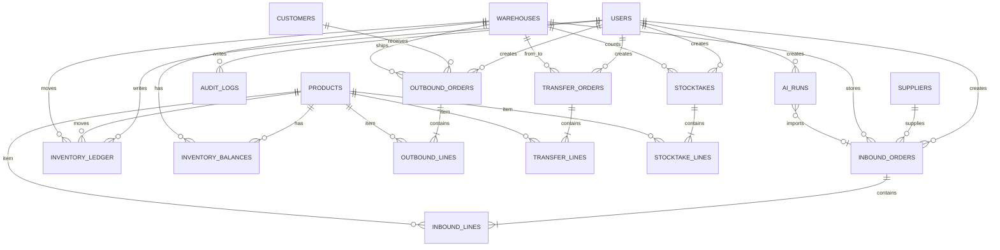

# Lager 仓储 · 数据模型设计

版本：1.1  
日期：2026-11-09  
数据库：SQLite 3（WAL）  
ORM：SQLAlchemy 2.x  
关联：[架构](02-architecture.md)、[API](04-api-spec.md)

## 1. 约定

- 主键：整数自增 `id`，内部使用；对外 API 也使用 `id`，单据同时暴露 `order_no`。
- 时间：全部以 UTC 存储（`UTCDateTime` 类型装饰器），API 输出带 `Z` 的 ISO 8601；前端转本地时区展示。
- 数量：`NUMERIC(18,4)`，内部 `Decimal`，API 以 JSON number 输出；展示最多 4 位小数。
- 金额/单价：`NUMERIC(18,4)`，API 输出 number；页面展示 2 位。
- 布尔：SQLite `INTEGER 0/1`，SQLAlchemy `Boolean`。
- 软删除：主数据使用 `is_active` 停用，不物理删除；单据不删除已确认记录。
- 命名：表名复数蛇形；外键 `xxx_id`；唯一约束 `uq_`；索引 `ix_`；检查约束 `ck_`。
- 字符集：UTF-8；所有文本字段有长度上限。

## 2. ER 图

## 3. 枚举

### 3.1 角色 `Role`

| 值 | 名称 | 说明 |
|---|---|---|
| `ADMIN` | 管理员 | 全部权限，含用户管理、审计 |
| `MANAGER` | 仓库主管 | 业务与主数据全权，不含用户管理 |
| `OPERATOR` | 仓管员 | 单据录入/确认/取消、只读主数据 |
| `VIEWER` | 只读 | 全部只读 |

### 3.2 单据状态 `DocumentStatus`

| 值 | 说明 | 可编辑 | 可删除 |
|---|---|---|---|
| `DRAFT` | 草稿 | 是 | 是（物理删除草稿） |
| `CONFIRMED` | 已确认 | 否 | 否 |
| `CANCELLED` | 已取消 | 否 | 否 |

> 入库/出库/调拨使用 `DocumentStatus`。取消仅对 `DRAFT` 生效；已确认单据不可取消，只能通过反向业务或库存调整纠错。这样避免“反审核”造成的库存和成本追溯难题。

### 3.3 盘点状态 `StocktakeStatus`

| 值 | 说明 |
|---|---|
| `DRAFT` | 已创建，未开始录入 |
| `COUNTING` | 录入中（保存过实盘数） |
| `COMPLETED` | 已确认，差异已入账 |
| `CANCELLED` | 已取消 |

### 3.4 库存变动类型 `MovementType`

| 值 | 方向 | 来源 |
|---|---|---|
| `INBOUND` | + | 入库单确认 |
| `OUTBOUND` | − | 出库单确认 |
| `TRANSFER_OUT` | − | 调拨单确认（源仓） |
| `TRANSFER_IN` | + | 调拨单确认（目标仓） |
| `STOCKTAKE_GAIN` | + | 盘点盘盈 |
| `STOCKTAKE_LOSS` | − | 盘点盘亏 |
| `ADJUSTMENT` | +/− | 库存调整 |

### 3.5 审计动作 `AuditAction`

`LOGIN`、`LOGOUT`、`LOGIN_FAILED`、`CREATE`、`UPDATE`、`DELETE`、`CONFIRM`、`CANCEL`、`PASSWORD_CHANGE`、`ADJUST`、`USER_DISABLE`。

## 4. 表定义

### 4.1 `users` 用户

| 列 | 类型 | 约束 | 说明 |
|---|---|---|---|
| `id` | INTEGER | PK | |
| `username` | VARCHAR(50) | NOT NULL, UNIQUE | 登录名，3–50，字母数字下划线 |
| `password_hash` | VARCHAR(255) | NOT NULL | PBKDF2-SHA256 |
| `display_name` | VARCHAR(80) | NOT NULL | 显示名 |
| `role` | VARCHAR(20) | NOT NULL, CHECK in roles | 默认 VIEWER |
| `is_active` | BOOLEAN | NOT NULL DEFAULT 1 | 停用后不能登录 |
| `token_version` | INTEGER | NOT NULL DEFAULT 0 | 改密/登出递增，使旧 JWT 失效 |
| `must_change_password` | BOOLEAN | NOT NULL DEFAULT 0 | 初始管理员为 1，仅提示不阻断 |
| `created_at` | DATETIME | NOT NULL | UTC |
| `updated_at` | DATETIME | NOT NULL | UTC |

索引：`uq_users_username`。  
规则：最后一个启用的 ADMIN 不能被停用或降级；不能停用自己。

### 4.2 `products` 商品

| 列 | 类型 | 约束 | 说明 |
|---|---|---|---|
| `id` | INTEGER | PK | |
| `sku` | VARCHAR(50) | NOT NULL, UNIQUE | 编码，大写字母数字-_. |
| `name` | VARCHAR(120) | NOT NULL | 名称 |
| `category` | VARCHAR(60) | NOT NULL DEFAULT '' | 分类（自由文本） |
| `spec` | VARCHAR(120) | NOT NULL DEFAULT '' | 规格 |
| `unit` | VARCHAR(20) | NOT NULL DEFAULT '件' | 单位 |
| `barcode` | VARCHAR(64) | NULL | 条码，可空 |
| `safety_stock` | NUMERIC(18,4) | NOT NULL DEFAULT 0 | 安全库存，用于低库存预警 |
| `reference_cost` | NUMERIC(18,4) | NOT NULL DEFAULT 0 | 参考成本，仅录入参考，不参与账面 |
| `reference_price` | NUMERIC(18,4) | NOT NULL DEFAULT 0 | 参考售价 |
| `remark` | VARCHAR(240) | NOT NULL DEFAULT '' | 备注 |
| `is_active` | BOOLEAN | NOT NULL DEFAULT 1 | |
| `created_at` | DATETIME | NOT NULL | |
| `updated_at` | DATETIME | NOT NULL | |

索引：`uq_products_sku`，`ix_products_name`，`ix_products_category`。  
规则：删除商品会级联清除该商品的 `inventory_balances` 与 `inventory_ledger`，因此有库存也可删除；但被历史单据行引用时必须停用，不能硬删除，避免单据行失去商品。停用保留全部历史库存与流水。

### 4.3 `warehouses` 仓库

| 列 | 类型 | 约束 | 说明 |
|---|---|---|---|
| `id` | INTEGER | PK | |
| `code` | VARCHAR(30) | NOT NULL, UNIQUE | 如 WH-SH |
| `name` | VARCHAR(80) | NOT NULL | |
| `location` | VARCHAR(160) | NOT NULL DEFAULT '' | 地址/区域 |
| `manager` | VARCHAR(80) | NOT NULL DEFAULT '' | 负责人 |
| `remark` | VARCHAR(240) | NOT NULL DEFAULT '' | 备注 |
| `is_active` | BOOLEAN | NOT NULL DEFAULT 1 | |
| `created_at` | DATETIME | NOT NULL | |
| `updated_at` | DATETIME | NOT NULL | |

规则：停用仓库前必须所有余额为 0；至少保留一个启用仓库；无库存且无单据引用允许删除。

### 4.4 `suppliers` 供应商

| 列 | 类型 | 约束 |
|---|---|---|
| `id` | INTEGER PK | |
| `code` | VARCHAR(30) NOT NULL UNIQUE | |
| `name` | VARCHAR(120) NOT NULL | |
| `contact_person` | VARCHAR(80) NOT NULL DEFAULT '' | |
| `phone` | VARCHAR(40) NOT NULL DEFAULT '' | |
| `email` | VARCHAR(120) NOT NULL DEFAULT '' | |
| `address` | VARCHAR(240) NOT NULL DEFAULT '' | |
| `remark` | VARCHAR(240) NOT NULL DEFAULT '' | |
| `is_active` | BOOLEAN NOT NULL DEFAULT 1 | |
| `created_at` / `updated_at` | DATETIME NOT NULL | |

### 4.5 `customers` 客户

字段与供应商一致（`code`、`name`、`contact_person`、`phone`、`email`、`address`、`remark`、`is_active`、时间戳）。

### 4.6 `inventory_balances` 库存余额

| 列 | 类型 | 约束 | 说明 |
|---|---|---|---|
| `id` | INTEGER | PK | |
| `product_id` | INTEGER | FK products, NOT NULL | |
| `warehouse_id` | INTEGER | FK warehouses, NOT NULL | |
| `quantity` | NUMERIC(18,4) | NOT NULL DEFAULT 0, CHECK >= 0 | 当前数量 |
| `avg_cost` | NUMERIC(18,4) | NOT NULL DEFAULT 0, CHECK >= 0 | 移动加权平均成本 |
| `updated_at` | DATETIME | NOT NULL | |

约束：`uq_balances_product_warehouse (product_id, warehouse_id)`；索引 `ix_balances_warehouse`、`ix_balances_product`。  
说明：余额行在第一次入库/调整时创建；零库存行可保留（用于成本与盘点），列表可过滤零库存。

### 4.7 `inventory_ledger` 库存流水（不可变）

| 列 | 类型 | 约束 | 说明 |
|---|---|---|---|
| `id` | INTEGER | PK | |
| `product_id` | INTEGER | FK, NOT NULL | |
| `warehouse_id` | INTEGER | FK, NOT NULL | |
| `movement_type` | VARCHAR(30) | NOT NULL | MovementType |
| `change_qty` | NUMERIC(18,4) | NOT NULL, CHECK != 0 | 正入负出 |
| `unit_cost` | NUMERIC(18,4) | NOT NULL DEFAULT 0 | 本次成本 |
| `balance_after` | NUMERIC(18,4) | NOT NULL, CHECK >= 0 | 变动后余额 |
| `ref_type` | VARCHAR(20) | NOT NULL | INBOUND/OUTBOUND/TRANSFER/STOCKTAKE/ADJUST |
| `ref_id` | INTEGER | NULL | 来源单据 id |
| `ref_no` | VARCHAR(40) | NOT NULL DEFAULT '' | 来源单号 |
| `remark` | VARCHAR(240) | NOT NULL DEFAULT '' | |
| `created_by` | INTEGER | FK users, NULL | 系统任务可空 |
| `created_at` | DATETIME | NOT NULL | |

索引：`ix_ledger_product_time (product_id, created_at)`、`ix_ledger_warehouse_time (warehouse_id, created_at)`、`ix_ledger_ref (ref_type, ref_id)`。  
规则：只插入，不更新/删除；所有库存变化必须产生流水。

### 4.8 `inbound_orders` 入库单

| 列 | 类型 | 约束 | 说明 |
|---|---|---|---|
| `id` | INTEGER | PK | |
| `order_no` | VARCHAR(40) | NOT NULL UNIQUE | IN-YYYYMMDD-0001 |
| `supplier_id` | INTEGER | FK suppliers, NULL | 可无供应商（如退货入库） |
| `warehouse_id` | INTEGER | FK warehouses, NOT NULL | 入哪个仓 |
| `related_no` | VARCHAR(40) | NOT NULL DEFAULT '' | 关联单号/来源单号 |
| `expected_date` | DATE | NULL | 预计到货日 |
| `status` | VARCHAR(20) | NOT NULL DEFAULT DRAFT | |
| `remark` | VARCHAR(240) | NOT NULL DEFAULT '' | |
| `total_quantity` | NUMERIC(18,4) | NOT NULL DEFAULT 0 | 明细合计 |
| `total_amount` | NUMERIC(18,4) | NOT NULL DEFAULT 0 | 数量×成本合计 |
| `created_by` | INTEGER | FK users, NOT NULL | |
| `confirmed_by` | INTEGER | FK users, NULL | |
| `confirmed_at` | DATETIME | NULL | |
| `created_at` / `updated_at` | DATETIME | NOT NULL | |

索引：`ix_inbound_status`、`ix_inbound_created_at`、`ix_inbound_warehouse`。

### 4.9 `inbound_lines` 入库明细

| 列 | 类型 | 约束 |
|---|---|---|
| `id` | INTEGER PK | |
| `order_id` | INTEGER FK inbound_orders ON DELETE CASCADE, NOT NULL | |
| `product_id` | INTEGER FK products, NOT NULL | |
| `quantity` | NUMERIC(18,4) NOT NULL, CHECK > 0 | |
| `unit_cost` | NUMERIC(18,4) NOT NULL DEFAULT 0, CHECK >= 0 | |
| `amount` | NUMERIC(18,4) NOT NULL DEFAULT 0 | 冗余=quantity×unit_cost |
| `remark` | VARCHAR(160) NOT NULL DEFAULT '' | |

约束：`uq_inbound_line (order_id, product_id)`；索引 `ix_inbound_lines_order`。

### 4.10 `outbound_orders` 出库单

| 列 | 类型 | 约束 | 说明 |
|---|---|---|---|
| `id` | INTEGER PK | | |
| `order_no` | VARCHAR(40) NOT NULL UNIQUE | OUT-YYYYMMDD-0001 | |
| `customer_id` | INTEGER FK customers NULL | | 可无客户 |
| `warehouse_id` | INTEGER FK warehouses NOT NULL | | 从哪个仓出 |
| `related_no` | VARCHAR(40) NOT NULL DEFAULT '' | | 关联单号/客户单号 |
| `expected_date` | DATE NULL | | 预计发货日 |
| `status` | VARCHAR(20) NOT NULL DEFAULT DRAFT | | |
| `remark` | VARCHAR(240) NOT NULL DEFAULT '' | | |
| `total_quantity` | NUMERIC(18,4) NOT NULL DEFAULT 0 | | |
| `created_by` / `confirmed_by` | INTEGER FK users | | |
| `confirmed_at` | DATETIME NULL | | |
| `created_at` / `updated_at` | DATETIME NOT NULL | | |

### 4.11 `outbound_lines` 出库明细

`id`、`order_id`（CASCADE）、`product_id`、`quantity > 0`、`remark`。唯一 `(order_id, product_id)`。

### 4.12 `transfer_orders` 调拨单

| 列 | 类型 | 约束 |
|---|---|---|
| `id` | INTEGER PK | |
| `order_no` | VARCHAR(40) NOT NULL UNIQUE | TRF-YYYYMMDD-0001 |
| `from_warehouse_id` | INTEGER FK warehouses NOT NULL | |
| `to_warehouse_id` | INTEGER FK warehouses NOT NULL | |
| `status` | VARCHAR(20) NOT NULL DEFAULT DRAFT | |
| `remark` | VARCHAR(240) NOT NULL DEFAULT '' | |
| `total_quantity` | NUMERIC(18,4) NOT NULL DEFAULT 0 | |
| `created_by` / `confirmed_by` | INTEGER FK users | |
| `confirmed_at` | DATETIME NULL | |
| `created_at` / `updated_at` | DATETIME NOT NULL | |

约束：`ck_transfer_diff_warehouse CHECK (from_warehouse_id <> to_warehouse_id)`。

### 4.13 `transfer_lines` 调拨明细

`id`、`order_id`（CASCADE）、`product_id`、`quantity > 0`、`remark`；唯一 `(order_id, product_id)`。

### 4.14 `stocktakes` 盘点单

| 列 | 类型 | 约束 |
|---|---|---|
| `id` | INTEGER PK | |
| `stocktake_no` | VARCHAR(40) NOT NULL UNIQUE | STK-YYYYMMDD-0001 |
| `warehouse_id` | INTEGER FK warehouses NOT NULL | |
| `status` | VARCHAR(20) NOT NULL DEFAULT DRAFT | |
| `remark` | VARCHAR(240) NOT NULL DEFAULT '' | |
| `created_by` | INTEGER FK users NOT NULL | |
| `completed_by` | INTEGER FK users NULL | |
| `completed_at` | DATETIME NULL | |
| `created_at` / `updated_at` | DATETIME NOT NULL | |

### 4.15 `stocktake_lines` 盘点明细

| 列 | 类型 | 约束 | 说明 |
|---|---|---|---|
| `id` | INTEGER PK | | |
| `stocktake_id` | INTEGER FK stocktakes CASCADE NOT NULL | | |
| `product_id` | INTEGER FK products NOT NULL | | |
| `book_quantity` | NUMERIC(18,4) NOT NULL DEFAULT 0 | 创建时账面快照 |
| `counted_quantity` | NUMERIC(18,4) NOT NULL DEFAULT 0 | 实盘数，创建时默认等于账面 |
| `difference_quantity` | NUMERIC(18,4) NOT NULL DEFAULT 0 | 实盘−账面 |
| `remark` | VARCHAR(160) NOT NULL DEFAULT '' | |

唯一 `(stocktake_id, product_id)`。  
规则：创建盘点时快照该仓库全部启用商品（无余额行的账面为 0）；同一仓库同时只允许一个 DRAFT/COUNTING 盘点。

### 4.16 `audit_logs` 审计日志

| 列 | 类型 | 约束 | 说明 |
|---|---|---|---|
| `id` | INTEGER PK | | |
| `user_id` | INTEGER FK users NULL | | 用户删除后置空 |
| `username_snapshot` | VARCHAR(50) NOT NULL DEFAULT '' | | 冗余，防用户改名 |
| `action` | VARCHAR(30) NOT NULL | | AuditAction |
| `entity_type` | VARCHAR(30) NOT NULL DEFAULT '' | | user/product/order/... |
| `entity_id` | INTEGER NULL | | |
| `entity_no` | VARCHAR(60) NOT NULL DEFAULT '' | | 单号/SKU |
| `summary` | VARCHAR(240) NOT NULL DEFAULT '' | | 人类可读 |
| `detail` | TEXT NOT NULL DEFAULT '{}' | | JSON 字符串，敏感字段脱敏 |
| `ip` | VARCHAR(64) NOT NULL DEFAULT '' | | |
| `created_at` | DATETIME NOT NULL | | |

索引：`ix_audit_created_at`、`ix_audit_user`、`ix_audit_entity (entity_type, entity_id)`。

### 4.17 `ai_settings` AI 设置（单例）

| 列 | 类型 | 约束 | 说明 |
|---|---|---|---|
| `id` | INTEGER PK | 固定 1 | 单例行 |
| `provider` | VARCHAR(20) NOT NULL DEFAULT 'DEEPSEEK' | | DEEPSEEK / OLLAMA |
| `deepseek_base_url` | VARCHAR(200) NOT NULL DEFAULT 'https://api.deepseek.com' | | 可换代理 |
| `deepseek_model` | VARCHAR(80) NOT NULL DEFAULT 'deepseek-flash' | | DeepSeek 模型 |
| `deepseek_api_key_enc` | VARCHAR(1024) NOT NULL DEFAULT '' | | Fernet 密文，空=未配置 |
| `deepseek_api_key_hint` | VARCHAR(16) NOT NULL DEFAULT '' | | 末 4 位掩码 |
| `ollama_base_url` | VARCHAR(200) NOT NULL DEFAULT 'http://127.0.0.1:11434' | | 本地/内网 |
| `ollama_model` | VARCHAR(80) NOT NULL DEFAULT 'qwen3.5:9b' | | 以 `ollama list` 为准 |
| `default_prompt` | TEXT NOT NULL | | 可编辑，建议保留 JSON 合同 |
| `auto_confirm` | BOOLEAN NOT NULL DEFAULT 1 | | 导入后自动确认 |
| `created_at` / `updated_at` | DATETIME NOT NULL | | |

单例行由 `service._get_setting` 在首次访问时创建；不存明文 API Key。

### 4.18 `ai_runs` AI 分析记录

| 列 | 类型 | 约束 | 说明 |
|---|---|---|---|
| `id` | INTEGER PK | | |
| `token_hash` | VARCHAR(128) NOT NULL UNIQUE | | sha256(预览 token)，不存明文 |
| `provider` | VARCHAR(20) NOT NULL | | 本次实际提供方 |
| `model` | VARCHAR(80) NOT NULL | | 实际模型名 |
| `source_type` | VARCHAR(10) NOT NULL | | IMAGE / LINK / TEXT |
| `source_summary` | VARCHAR(500) NOT NULL DEFAULT '' | | 来源摘要，不含密钥 |
| `prompt_version` | VARCHAR(40) NOT NULL DEFAULT '' | | 内置版本 |
| `result_json` | TEXT NOT NULL DEFAULT '{}' | | 校验后的预览 JSON |
| `status` | VARCHAR(20) NOT NULL DEFAULT 'PREVIEW' | | PREVIEW/IMPORTED/FAILED |
| `imported_order_id` | INTEGER FK inbound_orders NULL | | 失败/草稿时可为空 |
| `created_by` | INTEGER FK users NOT NULL | | 只能本人导入 |
| `created_at` | DATETIME NOT NULL | | 30 分钟 TTL 起点 |
| `imported_at` | DATETIME NULL | | |

索引：`token_hash` 唯一；`(created_by, created_at)` 普通索引。  
规则：token 一次性；`PREVIEW` 超过 30 分钟视为过期；成功导入只能发生一次；`result_json` 不存原始图片/网页全文。

## 5. 派生字段与一致性

| 字段 | 来源 | 维护方式 |
|---|---|---|
| `inbound_orders.total_quantity/total_amount` | 明细 | 服务层每次保存时重算 |
| `outbound_orders.total_quantity` | 明细 | 保存时重算 |
| `transfer_orders.total_quantity` | 明细 | 保存时重算 |
| `stocktake_lines.difference_quantity` | 实盘−账面 | 录入时计算 |
| `inventory_balances.quantity` | 流水累计 | 仅 inventory service 更新 |
| `avg_cost` | 入库加权 | 仅 inventory service 更新 |

不允许数据库触发器做业务计算；业务集中在 service，便于测试与移植 PostgreSQL。

## 6. 常用查询与索引

1. 库存列表：`balances JOIN products JOIN warehouses`，按仓库 + 关键字过滤；索引 `ix_balances_warehouse`。
2. 低库存：`quantity <= products.safety_stock AND safety_stock > 0`；报表层过滤。
3. 流水：按商品/仓库/时间倒序；联合索引覆盖。
4. 单据列表：状态 + 创建时间倒序；索引 `ix_*_status`、`ix_*_created_at`。
5. 审计：时间倒序 + 用户/动作过滤。
6. 工作台趋势：按日期聚合 ledger；v1 数据量小，直接 `GROUP BY date(created_at)`。

## 7. 数据库初始化与迁移

- 启动时 `Base.metadata.create_all()` 建表；幂等。
- PRAGMA：`journal_mode=WAL`、`foreign_keys=ON`、`busy_timeout=10000`、`synchronous=FULL`。
- 种子：若 `users` 为空，创建管理员 `admin`（密码来自 `ADMIN_INITIAL_PASSWORD`，默认 `Admin@12345`），并写入示例仓库/商品/供应商/客户（仅首次）。
- v1 不引入 Alembic；`docs/10-roadmap.md` 记录迁移到 Alembic 的计划。升级前备份 `lager.db`。
- 备份：停止写入或使用 SQLite `.backup`；文档给出命令。

## 8. 数据保留

- 流水、已确认单据、审计日志永久保留。
- 草稿单据可删除。
- v1 不提供自动清理；数据量预期 < 100 万流水，SQLite 足够。

## 9. SQLite 与 PostgreSQL 差异注意

- `NUMERIC` 在 SQLite 以浮点存储，业务层用 `Decimal` 并在写入前量化到 4 位；报表合计可能有 0.0001 误差，展示 2 位。
- 日期函数 `date()` 可用；迁移 PostgreSQL 时改为 `date_trunc`。
- 自增主键语法由 SQLAlchemy 处理。
- `CHECK` 约束在 SQLite 生效；确保建表时执行。
